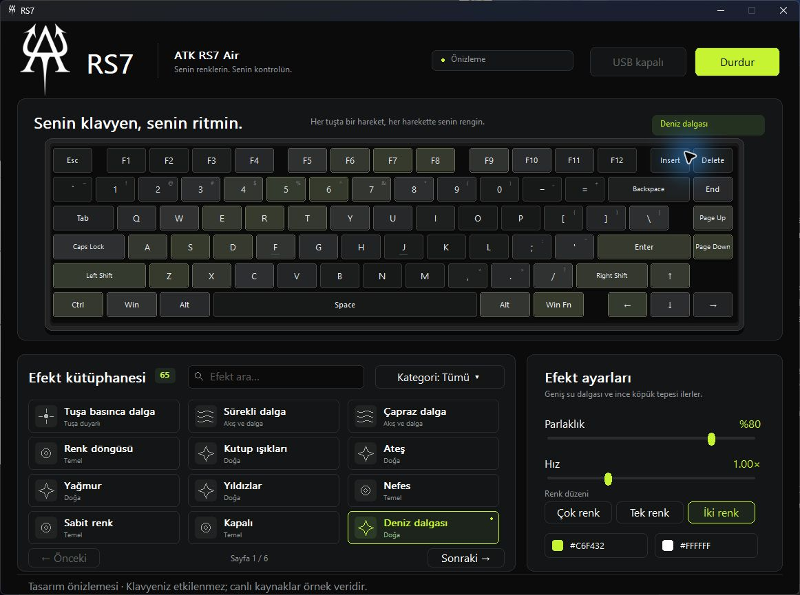

# RS7

ATK RS7 Air için Türkçe, yerel Windows RGB uygulaması. Rust ile yazılmıştır; kurulum, Rust, .NET, Electron veya ayrı bir yardımcı program gerektirmez.

[**Son sürümü indir**](https://github.com/tahayasinaks/rs7-isik/releases/latest) · [66 efektin kataloğu](docs/EFEKT-KATALOGU.md) · [Test planı](docs/TEST-PLANI.md)



## Kullanım

1. Releases → **RS7-v1.1.3-Windows-x64.exe** dosyasını indirin. Kaynak ZIP'i veya eski Onizleme EXE'sini kullanmayın.
2. Eski RS7 sürümünden tepsi simgesi → **Tamamen çık** ile çıkın; ATK HUB'ı kapatın.
3. Klavyeyi USB ile bağlayın, uygulamada **Klavyeyi bağla** seçin.
4. Bir efekt seçip **Başlat** seçin. Renk, hız ve parlaklık değişiklikleri çalışırken uygulanır.
5. **X / küçült**: efekt sistem tepsisinde devam eder. **Tamamen çık**: akış kapanır, USB bırakılır.

## v1.1.3 hotfix

Pencere artık kenarlardan boyutlandırılabilir ve ekranı kaplayabilir. Geniş pencerede kartlar, önizlemeler, yazılar ve ayar kontrolleri orantılı büyür. Dar pencerede paneller alt alta, kartlar iki sütuna geçer; gerekli olduğunda dikey kaydırma açılır. Gerçek uygulama pencere boyutunu ve konumunu hatırlar.

Yeni koyu renk seçici; renk alanı, ton şeridi, HEX/RGB girişleri, önceki/yeni renk karşılaştırması ve hazır tonlar sunar. Beyaz köşeler temizlendi. Gökkuşağında renkler otomatik akar; tek renkte bir, iki renkte iki renk kutusu gösterilir.

**Windows ile başlat** tercihi varsayılan olarak kapalıdır. Açarsanız kendi Windows oturumunuza girişte RS7 açılır; kapatırsanız başlangıç kaydı kaldırılır. Yönetici yetkisi gerekmez. Bu tercih uygulamayı açar; klavyeye bağlanma ve efekti başlatma elle yapılır. EXE'yi kalıcı bir klasörde tutun; taşıdıktan veya sürümü değiştirdikten sonra yeni dosyada tercihi kapatıp açın. Windows Başlangıç Uygulamaları üzerinden ayrıca devre dışı bırakılan kayıtların tekrar etkinleştirilmesi gerekebilir. Önizleme bu Windows ayarını değiştirmez.

## Özellikler

- 66 Türkçe seçenek; görsel kartlar, arama, yedi kategori ve altışarlı sayfalama.
- Dalga, deniz dalgası, kalp şekli, tuşa duyarlı desenler, doğal ve geometrik animasyonlar.
- Gökkuşağı, tek renk ve iki renk geçişi; %0–100 parlaklık ve 0.20×–3.00× hız. Tek renkli dalga ve geometrik desenler parlaklık geçişiyle hareketini korur.
- Windows ses çıkışına tepki (mikrofon açılmaz), birincil ekran renkleri, işlemci/bellek yükü ve saat.
- Üst barda duruma göre değişen bağlantı ve başlat/durdur düğmeleri.
- Şeffaf logo, 81 tuşlu canlı çizim; #0b0b0c / #ffffff / #c6f432 paleti.
- Tam çıkışta efekt/renk/hız/parlaklık kaydedilir; sonraki açılışta geri yüklenir. Bağlanma ve başlatma kullanıcının kontrolündedir.
- Tek örnek, Explorer yeniden başlarsa tepsi simgesini geri ekleme; USB döngüsü arayüz çiziminden ayrıdır.

Bazı modlarda hız veya palet anlamlı değildir ve ilgili denetim pasiftir. Sabit renk birinci rengi kullanır. Ekran modları kendi ekran renklerini kullanır; parlaklık ayarlanabilir. Ses seviye çubukları kanal seviyesidir, frekans ekolayzırı değildir. CPU göstergesi yükü gösterir; sıcaklık ölçmez.

## Doğrulama ve sınırlar

28 otomatik Rust testi; efektlerin örnek çıktıları, parlaklık sınırı, tek renkte hareket, Türkçe arama, tuş/LED eşlemesi, USB paketleri, ayar kaydı ve gömülü logo yüklemesi için çalışır. Yerel Windows canlı kaynak entegrasyon testi ayrıca çalıştırılır; CI'da masaüstü/ses aygıtı gerektirdiği için varsayılan olarak atlanır.

Fiziksel test cihazı USB 373b:1220 / firmware 2.02 kullanan RS7 Air'dir. Önceki sürümlerde bağlantı, tam çıkış ve X ile tepside kesintisiz devam etme doğrulandı. Yeni 66 seçeneğin tümü gerçek cihazda tek tek doğrulanmış değildir; [test planıyla](docs/TEST-PLANI.md) kontrol edebilirsiniz. Diğer firmware varyantları henüz fiziksel test edilmedi.

Animasyonlar bilgisayarda hesaplanır; tamamen çıkıştan sonra klavye firmware'ine özel efekt yüklenmiş olmaz. Fn algılanmaz; Windows tuş olayları kullanıldığından başka klavyeler de tepkiyi tetikleyebilir. Tuşlar, ses ve ekran örnekleri dosyaya/ağa yazılmaz. HDR, korumalı video veya özel ses kiplerinde canlı kaynak kısıtları olabilir; ayrıntılar katalogdadır.

EXE dijital imzalı değildir; Windows Akıllı Uygulama Denetimi bazı bilgisayarlarda çalışmasını engelleyebilir. Bu hotfix imzalama sorununu çözmez. Açık kaynak lisansı kod imzasının yerini tutmaz. Proje [MIT lisanslıdır](LICENSE) ve ATK ile bağlantılı resmî bir ürün değildir.

## Derleme

Windows + Rust stable:

```text
cargo test --locked
cargo build --release --locked
```

MSVC: Windows SDK / Visual C++ build araçları. C/C++ çalışma zamanı statik bağlanır. GNU: uygun GNU bağlama araçları ve ikon kaynağı için windres gerekir. Çıktı: target/release/rs7-isik.exe. Kullanıcı bilgisayarında derleme araçları gerekmez.

EXE adında Onizleme bulunursa veya --design-preview argümanı verilirse USB'siz tasarım modu açılır; canlı kaynaklar örnektir, ayarlar yazılmaz. Releases dosyası gerçek klavyeyi yöneten sürümdür.

Kaynak: src/lighting.rs ve src/lighting/extended.rs efektler; src/hardware.rs HID; src/worker.rs gönderim; src/sources.rs canlı kaynaklar; src/win_ui.rs ve alt modüller arayüz. Eski Electron kaynakları tarihçe için korunur; Rust EXE bunları kullanmaz.

## Yayınlar

Sürüm sırası v1.0.0 → v1.0.1 → v1.1.0 → v1.1.1 → v1.1.2 → **v1.1.3**. Her yayın EXE, SHA-256, Türkçe notlar ve kaynak etiketi içerir. [Yayınlama kılavuzu](docs/YAYINLAMA.md).
